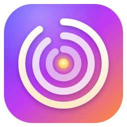
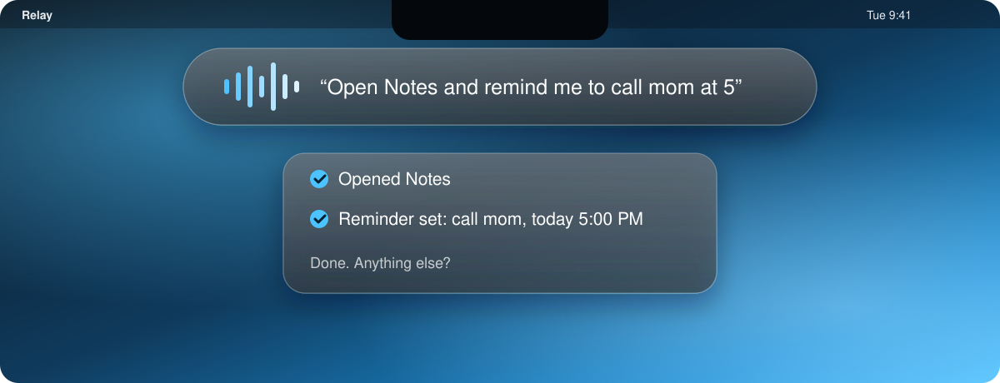
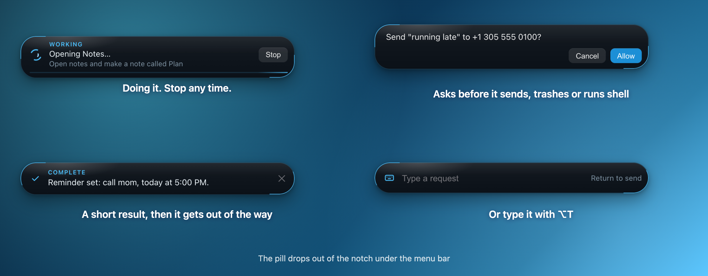
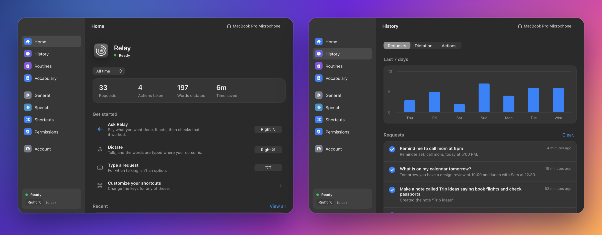
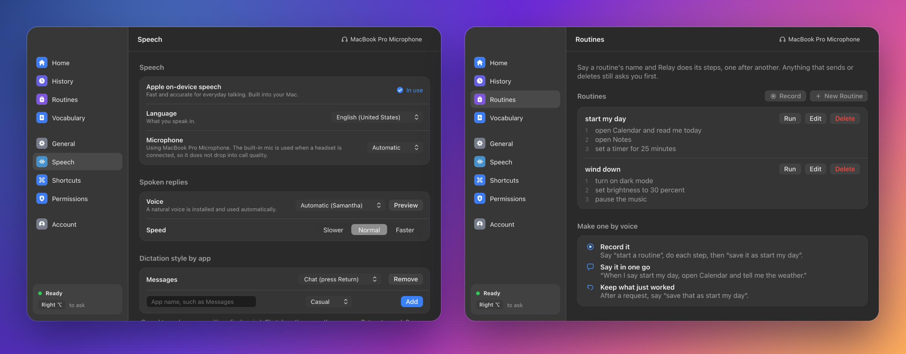
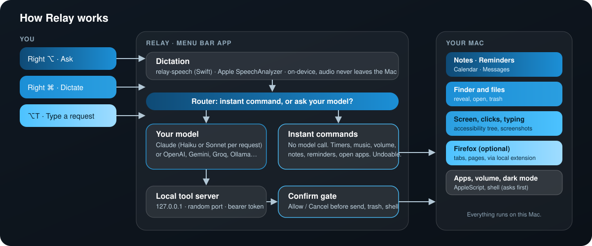
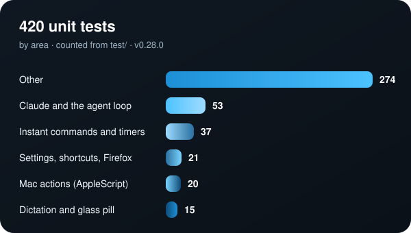
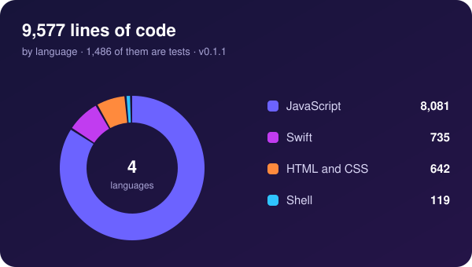
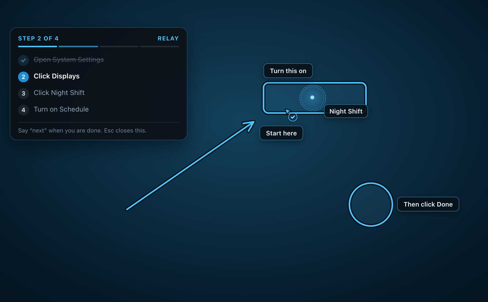
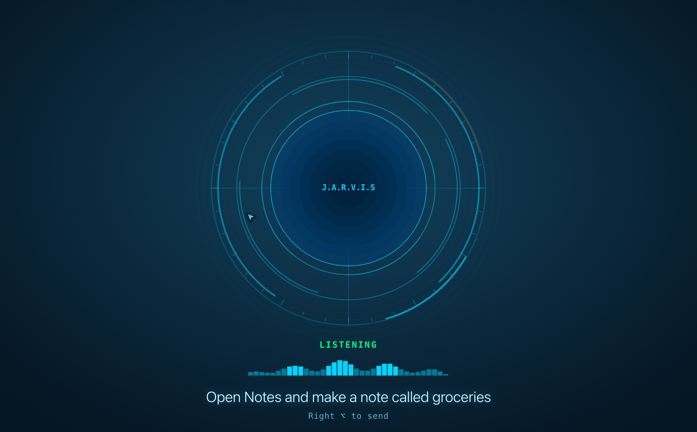

<p align="center">
  
</p>

<h1 align="center">Relay</h1>

<p align="center"><b>Talk to your Mac. Relay does the rest.</b><br>
A menu bar assistant that opens apps, writes notes and reminders, reads your calendar, clicks through interfaces, drives Firefox and types what you say into any app.<br>
<b>No API key: it runs on the Claude plan you already have.</b></p>

<p align="center">
  <a href="https://github.com/serjdmitri/Relay/releases"></a>
  
  
  
  
  
  
  <a href="LICENSE"></a>
</p>

<p align="center">
  
</p>

Dictation is built in (Apple's on-device speech recognition), so a separate dictation app is no longer needed. It started as a companion for [Talkify](https://github.com/tornikegomareli/Talkify); you can still use Talkify or any tool that types or pastes text, because the Ask box (`⌥T`) is an ordinary text field.

**[Website](https://serjdmitri.github.io/Relay/)** | **[Releases](https://github.com/serjdmitri/Relay/releases)** | [Download](#download) | [Build from source](#install-from-source-on-your-mac) | [Using it](#using-it) | [What is verified](#what-is-verified-and-what-is-not)

> **Status: early (v0.7.1).** The agent, dictation, interface and tests run on a Mac, but many flows have only been tried by hand. Expect rough edges and please open an issue with what the **History > Actions** tab shows.

> **How it runs.** Relay uses your own [Claude Code](https://claude.ai/code), signed in to your Claude plan (Pro or Max), so you need no API key. Relay never sees your password; it runs the real `claude` program. Relay is an independent project and is not made or endorsed by Anthropic, and Anthropic's rules for third-party apps can change. If they do, an **API key** (Anthropic, OpenAI, Gemini, Groq, Mistral, xAI, DeepSeek or any OpenAI-compatible address) or a local **Ollama** model keeps Relay working: Account > "Use an API key or a local model instead".

Relay is an independent project. It is not affiliated with Anthropic, [Talkify](https://github.com/tornikegomareli/Talkify) or Octaflow. The window, pages and pill follow Octaflow's layout, with original code, name and icon.

## Download

Tagged versions and release notes are on the [Releases page](https://github.com/serjdmitri/Relay/releases). The `.dmg` files on each release are built by GitHub Actions (`.github/workflows/release.yml`) from the tagged source: `arm64` for Apple Silicon, `x64` for Intel. Both need **macOS 26 or later**. Open the `.dmg` and drag Relay to Applications.

Relay is not notarized by Apple (that needs a paid developer account), so the first launch is blocked by Gatekeeper. Right-click Relay in Applications and choose **Open**, then **Open** again, or run:

```bash
xattr -dr com.apple.quarantine /Applications/Relay.app
```

You will approve Microphone, Accessibility, Screen Recording and Input Monitoring once. Ad-hoc signed downloads change identity with every release, so macOS asks again after you update.

## See it

<p align="center">
  
</p>

<p align="center">
  <br>
  
</p>

These are the real interface pages rendered with sample data, so no personal information is shown. Regenerate them with `npm run shots && npm run readme-images`.

## How it works

<p align="center">
  
</p>

## By the numbers

<p align="center">
  
  
</p>

The charts are drawn from the repository itself by `npm run charts` (tests are counted from `test/`, lines from the source files).

<a href="https://star-history.com/#serjdmitri/Relay&Date">
  
</a>

## Install from source (on your Mac)

Needs Node 20+ (`brew install node`), Xcode or the command line tools (`xcode-select --install`, for the dictation helper), macOS 26 or later, and [Claude Code](https://claude.ai/code) signed in to your Claude account (Relay can do the sign-in for you).

```bash
git clone https://github.com/serjdmitri/Relay.git
cd Relay
npm install
npm run pack
rm -rf /Applications/Relay.app && cp -R dist/mac-arm64/Relay.app /Applications/   # dist/mac on Intel
open /Applications/Relay.app
```

`npm run pack` builds the dictation helper, builds the app and signs it. Always run the packaged app, not `npm start`: macOS ties permissions to the app's identity.

Run `npm run signing` once. It creates a local certificate, "Relay Local Signing", in your login keychain, and every build is then signed with it. That gives Relay a stable identity, so macOS keeps Accessibility, Input Monitoring, Microphone and Screen Recording across rebuilds. Without it the build is signed ad-hoc and macOS asks for all of them again after every rebuild.

First launch walks you through: sign in with Claude, Microphone, Accessibility, Screen Recording, Input Monitoring, optional Firefox extension, a dictation check, then a first request.

## Using it

| Shortcut | What it does |
|---|---|
| **Right ⌥** (tap, or hold) | Ask. Talk, then tap again (or let go). Relay does it and the pill shows a short reply. |
| **Right ⌘** (tap, or hold) | Dictate. Talk, and the words are typed where your cursor is. |
| **⌥T** | Type a request instead of talking. |
| **Esc** | Cancel. Tapping Right ⌥ while Relay works also stops it. |

All three can be changed in Shortcuts. Anything that sends a message, moves things to the Trash, runs a shell command or runs a destructive-looking AppleScript shows an Allow / Cancel card first.

### Show me
<p align="center">
  <br>
  <sub>The cyan look: the real overlay page, rendered over a sample wallpaper. General > Look switches to the Classic indigo orb.</sub>
</p>

Ask "where do I turn on Night Shift?" or "walk me through connecting a printer". Relay points at the exact element (found through the accessibility tree, so it works even with models that cannot see images), can draw boxes, circles, arrows and labels over your screen, and for several steps shows a small card and outlines each step in turn. Click the outlined spot, or say "next", to go on; "back" and "stop" work too. Relay checks what you do: if you go another way, or the next control is not where it expected, it looks at the screen and rewrites the remaining steps. Elements are found through the accessibility tree (a small native helper, `relay-ax`, that answers in about half a second), or by reading the text on the screen when an app has no accessibility names. Marks stay about 30 seconds, or until you press **Esc** or start a new request. While Relay listens and works, a small buddy follows your pointer. Both can be switched off in General (Relay cursor, Buddy cursor). They work on every display and are hidden while Relay takes a screenshot, so the model never sees them.

### The reactor
<p align="center">
  <br>
  <sub>The real overlay page, rendered over a sample wallpaper.</sub>
</p>

When you ask by voice, a big Jarvis arc reactor appears in the middle of your screen (no window behind it) and follows your voice; your words appear under it. When you stop talking it stays there while Relay works in the background, shows the answer, and goes away when the task is done. A small arrow follows your pointer like a second cursor and flies to what Relay points at; put it away with General > Cursor buddy. Turn on **Listen for “Hey Jarvis”** (General, or the menu bar icon) to start without a key: Relay listens on this Mac for your wake phrase (nothing is recorded or sent), chimes, then takes your request and stops on its own when you stop talking. Typing (⌥T) and Allow / Cancel questions still use the pill.

### Several asks at once
Ask for another thing while Relay is working: tap the ask key again and say it. Requests run one after another, and the ones you asked this round are listed as bullets on the middle left of the screen (the running one bright, waiting ones dim, finished ones ticked). Esc stops the work and drops the waiting ones.

### Interrupt it
Esc, ⌥T, or starting to talk again cuts Relay off mid-sentence; the menu bar icon has Stop Speaking too. (Relay does not listen for your voice while it talks, so it cannot hear "stop".)

### Drop files on it
Drag files or a folder onto the menu bar icon (or anywhere on the Relay window) and Relay asks what to do with them. It can read text, PDFs, Word and RTF files, and pictures, and only the ones you dropped. They stay available for ten minutes.

### Dictation learns your words
After you dictate, Relay looks at the same text in the field a few seconds later. A word you fixed by hand, twice, becomes a word fix in Vocabulary. Only the changed words are kept, password fields are never read, and General > Learn my words from corrections turns it off.

### Background agents
"In the background, research the best noise cancelling headphones and save it in a note." "Start an agent to summarize my trip notes." Relay answers at once; the agent works by itself and its progress shows in the top right of the screen, then a short result. Up to three at once. "What are my agents doing?" lists them, "stop all agents" ends them. Agents can search the web, read pages and files you dropped, read and write Notes and Reminders and read the Calendar; they cannot see or control your screen or send or delete anything.

### Scheduled requests
"Every weekday at 8, open my email." "Every Monday and Thursday at 9, play focus music." "Schedule open my email for tomorrow at 7am." Relay runs it by itself at that time (the Mac must be on and Relay open). "What's scheduled?", "cancel the email schedule" and Settings > Routines list, switch off and delete them. Anything that sends or deletes is declined unless you answer within 90 seconds; a run missed by more than 45 minutes is skipped with a notification.

### Memory
"Remember that my sister is Anna." Relay keeps short facts you tell it, uses them in later requests, and shows them in Settings > Memory, where you can add, delete, forget all, or turn it off. "Forget that…", "what do you remember about me?" and "forget everything" work by voice. Passwords and card numbers are refused. It stays on your Mac.

### Move windows
"Snap this window to the left", "put Chrome on the right half", "move Spotify to the top right corner", "maximize this window", "center Notes", "right third". Instant, no model, and "undo that" puts the window back.

### Remember a task by name
After Relay does something, say "remember this as morning setup". Next time you say "morning setup" it repeats the exact actions with no model and no waiting; anything that sends or deletes still asks first. "Forget morning setup" removes it.

### Better voices
Speech > More natural voices: OpenAI or ElevenLabs voices with your own key (they bill you, Relay takes nothing), or a free on-device voice (Kokoro, Apple Silicon, about 270 MB, downloaded when you press the button and checked against a pinned hash).

### Recent asks
Rest the pointer on the left edge of the screen for a moment and a black panel, centered on the edge like a Dock, pops out with your latest asks. Click one to ask it again; move away and it slides back. Turn it off in General or from the menu bar icon.

### Mark the screen
Hold the mark key (**Left ⌃** by default) and move the pointer round something (no clicking; a short cyan trail follows it and fades away behind the pointer), let go, then ask: "what is this?", "why is this red?", "fix this". Relay looks at the area you marked (with some of its surroundings) instead of guessing from a whole-screen picture. A model that cannot see images gets the text inside the area instead. The mark lasts three minutes, and Esc cancels it. Change the key under Shortcuts (use one modifier key on its own).

### Instant commands
These run at once, with no model call (about a third of a second):
- **Apps and files:** "open Notes", "switch to Safari", "quit Spotify", "open my Downloads folder"
- **Web:** "open github.com", "open YouTube" (the app if you have it, else the site), "google best pizza", "search YouTube for cats"
- **Music and video:** "pause", "play", "next song", "previous song" (Spotify, Music, or the media keys for a browser tab)
- **Timers:** "set a timer for 5 minutes", "how much time is left", "cancel my timer", "set an alarm for 7am" (Relay has to be running; one that comes due while it is closed fires on the next launch)
- **Reminders and notes:** "remind me to call mom at 5pm", "remind me tomorrow at 9 to send the invoice", "new note buy milk", "make a note called Ideas saying build a rocket"
- **System:** "volume down", "mute", "brightness up", "set brightness to 40 percent" (built-in display), "dark mode", "lock my screen", "turn off the display"
- **Facts:** "what time is it", "what's the date", "how much battery do I have"

Everything else goes to Claude.

### Follow-ups and undo
- **"Undo that"** reverses the last instant command (closes what it opened, restores the volume, brightness or dark mode, cancels the timer, deletes the note or reminder it made), takes back the last thing you dictated, or asks Claude to reverse what it just did.
- **"Do it again"** repeats your last request.
- Claude remembers the conversation for five minutes, so "make that bigger" or "now double it" works. Other providers get the last two exchanges as context.

### Screen and clipboard
"Summarize what I copied", "what did I highlight", "what's on my screen": Claude can read the clipboard (text or an image), the text selected in the front app, and a screenshot.

### Routines
- Say "start a routine", do steps, then "save it as start my day".
- Or "when I say start my day, open Calendar and tell me the weather".
- Or after a request, "save that as start my day".
- Then just say the name. Manage them in the Routines tab.

### Dictation
While dictating, say **"new line"** or **"new paragraph"** for line breaks, and **"scratch that"** to drop what you just said (on its own, it undoes the last paste). **Vocabulary > Word fixes** replaces words the recognizer gets wrong ("superbase" becomes "Supabase"), and **History > Dictation > Fix a Word…** makes one from a line you dictated. **Speech > Dictation style by app** types in lowercase with no final period for apps you choose (Messages, say), and can press Return after.

Speech is turned into words on this Mac by Apple's SpeechAnalyzer, through a small Swift helper (`native/relay-speech.swift`). Your voice is not sent anywhere; only the words go to Claude, and only when you ask Relay to do something. Language and microphone are in the Speech tab. With the default "Automatic" microphone, Relay uses the Mac's built-in mic whenever a Bluetooth headset (AirPods) is the system input, because opening a headset mic drops it into low-quality call mode with a delay. Terms you add under Vocabulary are passed to the recognizer as hints.

### The pill and menu bar
The pill is real see-through macOS glass (a small native helper, `native/relay-glass.swift`) that drops out of the notch and retracts into it; on a Mac older than macOS 26, or with **General > Liquid glass pill** off, it is a plain dark pill. The menu bar icon turns into a pulsing red badge while Relay listens and a blue one while it works.

### Spoken replies
Turn on **General > Speak replies**, then pick a voice and speed under **Speech > Spoken replies**. Relay uses the best voice it can find, and uses a natural (Siri, Premium or Enhanced) voice automatically once you have downloaded one: System Settings > Accessibility > Spoken Content > System Voice > Manage Voices. Apps cannot see those voices through Apple's speech API, so Relay speaks through the system `say` command.

### Claude account
Relay runs your own Claude Code (`claude`), already signed in to your Claude account, and gives it Relay's Mac tools over a local-only tool server (127.0.0.1, random port, bearer token). Sign in, sign out and pick the model on the Account page. The default, **Auto**, starts Claude while you are still talking, answers simple requests with Haiku (fastest), starts writing and planning requests on Sonnet, and moves a struggling Haiku request up to Sonnet in the same conversation, so nothing already done is repeated. Pick Haiku, Sonnet or Opus by hand to turn that off. An API key or a local Ollama model is still available under "Use an API key or a local model instead" (see below).

The Claude plan is the default, and no API key is needed. See the note at the top about how this relies on Claude Code.

### Other model services (an API key instead of your Claude plan)
Account > **Model service** also offers **OpenAI** (the ChatGPT API), **Google Gemini**, **Groq**, **Mistral**, **xAI (Grok)**, **DeepSeek** and a **Custom address** for anything that speaks the OpenAI chat format (LM Studio, OpenRouter and so on), next to the Anthropic API key and Ollama. Each service keeps its own key (stored encrypted with your Keychain) and its own model name, and there is a **Test** button. Model names change, so edit the name if the test fails. OpenAI and Gemini are treated as able to see screenshots; the others are text only, so Relay does not take screenshots with them. The OpenAI API is billed separately from a ChatGPT subscription.

### The window
The sidebar collapses to the left from the button in the top bar, or with ⌘\, so the page gets the whole window. Relay remembers the choice. The interface is neutral gray with one indigo accent; each page only tints the soft glow at the top and bottom and the selected sidebar item.

### Tools the agent has
Apps (list, open, focus, quit), URLs and files, Finder (reveal, list, trash), Notes, Reminders, Calendar, Messages (iMessage), type text, key presses, menu bar clicks, accessibility-tree clicks (`ui_list`/`ui_click`), screenshots, pixel clicks and scrolling, a Relay cursor overlay that glides to the target before clicking, a buddy cursor that follows your pointer, and show-me tools that point at an element, draw boxes, circles and arrows, and walk you through steps, web search and page fetch, volume and dark mode, raw AppleScript, shell. Firefox tab tools appear when the extension is connected.

### Firefox
Without the extension Relay can list and switch tabs (read from the tab strip), open URLs and use key presses and screenshots. With it, Relay can list and switch tabs, read page text, click and type inside pages. Turn it on in Permissions > Firefox and use **Show Me**: it opens `about:debugging` and the extension folder; choose "Load Temporary Add-on" and pick `manifest.json`. Firefox drops temporary add-ons on quit; Firefox Developer Edition can keep an unsigned one installed. The app only accepts connections from `moz-extension://` origins on 127.0.0.1.

### History > Actions
Every tool call with its arguments and result. If something does not work, look here first.

## What is verified and what is not

Verified on a Mac (`npm test`, 206 tests): shortcut tap/hold logic including Right ⌘ and Esc, the agent loop and confirm gate, the wire formats of the Anthropic, Ollama and OpenAI-compatible providers (with fake servers), the local tool server and the Claude runner (with a fake `claude`), the dictation helper's protocol, instant commands, AppleScript builders, settings migration, the Firefox bridge. Also run for real: the dictation helper transcribing generated speech, and the Claude runner driving real tool calls (including an image result and a declined confirmation) through a signed-in `claude`.

Not verified by script: real calls to the OpenAI-compatible services (OpenAI, Gemini, Groq, Mistral, xAI, DeepSeek), live microphone dictation end to end, music control, spoken-command dictation and word fixes with a real voice, the clipboard and selection tools, permission prompts, global shortcut detection, the AppleScript against Notes, Reminders, Calendar, Messages and Finder beyond what you have tried by hand. `scripts/e2e.mjs` and `scripts/screenshots.mjs` predate dictation and the Claude sign-in and have not been updated or re-run. The Actions tab and `Console.app` (filter "Relay") are where errors show up.

## Layout
```
src/main        Electron main process, agent, tools, speech and Claude runners, Firefox bridge
src/renderer    Window, onboarding, pill and cursor overlay (plain HTML/CSS/JS)
native          relay-speech.swift (on-device dictation and brightness), relay-glass.swift (the glass behind the pill)
extension/firefox   WebExtension (MV2)
test            unit tests         scripts   packaging, icons, screenshots, e2e
```

## Contributing

Issues and pull requests are welcome. Before opening a PR run `npm test` on a Mac. After changing the interface, `npm run shots && npm run readme-images` refreshes the pictures above (it needs Google Chrome, or set `CHROMIUM_PATH`). `scripts/e2e.mjs` (end-to-end run of the real app with a mock model) predates dictation and the Claude sign-in and needs updating before it is useful again.

## License

[MIT](LICENSE)
